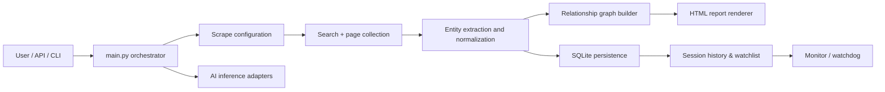
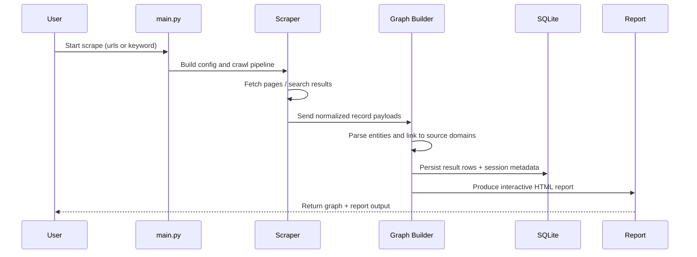

# Python OSINT Network Scraper

A Python-based OSINT and reconnaissance scraper designed to collect public web intelligence, normalize entities, and build relationship graphs from pages and search results. The project is structured around a modular domain-driven design, with a scraper engine, graph-building layer, SQLite persistence, AI-ready inference adapters, and HTML/interactive reporting.

## What the project does

The application can:

- Crawl pages or search results based on a URL list or keyword query
- Support shopping, OSINT, and custom scraping modes
- Extract entities such as emails, phone numbers, addresses, and related metadata
- Build a normalized graph that links source domains to discovered entities
- Save results in SQLite for session/history analysis
- Render relationship maps as HTML reports
- Monitor tracked URLs and notify when keyword or price conditions change
- Integrate with local or remote AI inference backends (Ollama, llama.cpp, llama.cpp server, Hugging Face, MLX, ONNX)

## Repository layout

- `src/main.py` — primary scraping engine and orchestrator
- `src/server.py` — lightweight Flask endpoint for triggering scrape jobs
- `src/database_manager.py` — SQLite persistence and session tracking
- `src/monitor.py` — periodic watchdog for alerting on monitored pages
- `src/domain/` — graph modeling, normalization, and inference domain contracts
- `src/infrastructure/` — HTML report rendering and inference backend adapters
- `src/presentation/` — UI/model wizard presentation layer
- `src/application/` — orchestration helpers and wizard logic
- `tests/` — graph, inference, and HTML-report validation tests
- `start.sh` — environment bootstrap and app launch script

## High-level architecture



## Core processing flow



## Functional areas

### 1. Scraping engine
The core orchestrator in `src/main.py` configures crawling behavior, builds query sets, manages recursion or page limits, and coordinates result ingestion. It supports different operational modes such as shopping and OSINT-focused retrieval.

### 2. Entity normalization
The domain layer (`src/domain/normalize.py`, `src/domain/graph.py`) normalizes raw metadata so values like emails, phones, and addresses are translated into stable entity IDs. This makes the graph consistent even when multiple pages report the same entity.

### 3. Relationship graphs
The project represents discovered facts as a graph with nodes (domains, emails, phones, addresses, people, organizations) and edges representing relationships like `HAS_PHONE`, `RESIDED_AT`, and `ASSOCIATED_WITH`. This graph is then rendered in an HTML report for exploration.

### 4. Persistence
`src/database_manager.py` manages SQLite tables for:

- `results` — scraped item data and extracted entity payloads
- `sessions` — historical scrape jobs and keywords
- `watchlist` — monitored URLs and conditions

### 5. Monitoring and alerts
`src/monitor.py` watches the database for active watchlist items and periodically checks target pages for keyword matches or price drops. Alerts can be surfaced via system notifications or console output.

### 6. Inference integration
The AI layer supports multiple backends and validates configuration before use. It is intentionally decoupled from the scraping engine so the app can run with local models or remote endpoints depending on deployment needs.

## Typical usage

### Run the app

```bash
chmod +x start.sh
./start.sh
```

### API trigger
The Flask server in `src/server.py` exposes a `/scrape` POST endpoint. It accepts JSON payloads with keys such as:

```json
{
  "keyword": "example company",
  "mode": "osint",
  "max_pages": 5,
  "scrape_images": true,
  "use_ai": false
}
```

## Design notes

- The domain layer tries to remain independent of UI details and external APIs.
- Graph construction is strongly based on normalized entity identity rather than raw string matching.
- The HTML report is a lightweight interactive visualization layer that avoids heavier JavaScript graph libraries.
- Sessions and watchlist data are persisted locally to a SQLite database, making the scraper useful for repeated monitoring tasks.

## Testing

The project includes tests covering graph construction, report generation, and inference backend validation. Examples include:

- `tests/test_graph.py`
- `tests/test_inference_factory.py`
- `tests/test_report_html.py`

## Summary

This repository combines web scraping, entity extraction, graph-based relationship mapping, and optional AI inference into a single OSINT-focused workflow. It is best understood as a local intelligence toolkit that turns loosely structured search results and web pages into structured, queryable relationships and reports.

## License and usage note

This project appears to be a security/OSINT tooling project. Use it only in compliance with the target platforms' terms of service, applicable laws, and ethical research boundaries. Avoid scraping or processing data without the relevant rights or permissions.

---

Repository: `jdgiles26/python-osint-network-scraper`
Language mix: Python-heavy project with supporting JavaScript and Shell tooling.

